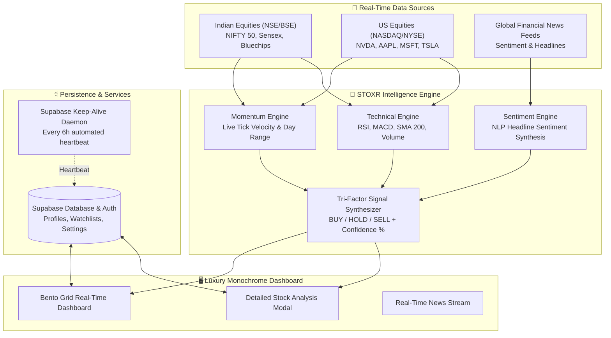

<div align="center">

  

  # ⚡ STOXR
  ### Autonomous Real-Time Financial Intelligence & Quantitative Signal Engine

  <p align="center">
    <b>High-frequency sentiment synthesis, multi-market live telemetry, and AI-driven signal generation built for modern quantitative analysts and retail traders.</b>
  </p>

  <div>
    <a href="https://react.dev/"></a>
    <a href="https://www.typescriptlang.org/"></a>
    <a href="https://vitejs.dev/"></a>
    <a href="https://tailwindcss.com/"></a>
    <a href="https://supabase.com/"></a>
    <a href="https://bun.sh/"></a>
  </div>

  <br />

  <p align="center">
    <a href="#-key-features">Key Features</a> •
    <a href="#️-system-architecture">System Architecture</a> •
    <a href="#-market-coverage">Market Coverage</a> •
    <a href="#-quick-start">Quick Start</a> •
    <a href="#-keep-alive-daemon">Keep-Alive Daemon</a> •
    <a href="#-project-structure">Project Structure</a> •
    <a href="#-license">License</a>
  </p>

</div>

---

## 🌟 Key Features

| Capability | Description | Status |
| :--- | :--- | :---: |
| 📈 **Live Market Telemetry** | Real-time price tracking, intraday candlestick/area charts across `1D`, `1W`, `1M`, `1Y`, and `ALL`. | 🟢 Active |
| 🧠 **Tri-Factor AI Signals** | Autonomous signal generation synthesizing price momentum, financial news sentiment, and quantitative indicators (RSI, MACD, 200 SMA). | 🟢 Active |
| 🇮🇳 **Dual-Exchange Support** | Native Indian equities (`NSE`/`BSE` NIFTY 50, Sensex) alongside US equities (`NASDAQ`/`NYSE`). | 🟢 Active |
| 🖤 **Luxury Monochrome UI** | Ultra-high contrast Bento-grid dashboard powered by Tailwind CSS, Radix UI primitives, and Framer Motion micro-interactions. | 🟢 Active |
| ⭐ **Live Watchlists** | Cloud-synced asset tracking with customizable instant alerts and price delta highlights. | 🟢 Active |
| 📰 **Sentiment News Stream** | Real-time global financial headlines mapped directly to ticker impact scores and market sentiment. | 🟢 Active |
| 🛡️ **Supabase Keep-Alive** | Autonomous standalone background worker ensuring zero-downtime database availability and preventing auto-pauses. | 🟢 Active |

---

## 🏛️ System Architecture



---

<details>
<summary><b>🔍 Deep Dive: The Tri-Factor AI Signal Engine (Click to expand)</b></summary>
<br />

The STOXR Signal Engine calculates trade confidence through a weighted tri-factor mathematical model:

$$\text{Signal Confidence} = \mathbf{w_t} \cdot S_{\text{tech}} + \mathbf{w_s} \cdot S_{\text{sent}} + \mathbf{w_m} \cdot S_{\text{mom}}$$

1. **Quantitative Technicals ($S_{\text{tech}}$)**:
   - 14-period Relative Strength Index (RSI) mean-reversion boundary checking.
   - Moving Average Convergence Divergence (MACD) signal line crossovers.
   - 200-period Exponential Moving Average (EMA) trend positioning.
2. **News Sentiment Analysis ($S_{\text{sent}}$)**:
   - Real-time headline token analysis classifying sentiment into Bullish, Neutral, or Bearish matrices.
3. **Momentum & Volume Velocity ($S_{\text{mom}}$)**:
   - Day range percentage, current volume vs. average 30-day volume expansion.

</details>

---

## 🌐 Supported Markets

STOXR seamlessly manages international currency representations, exchange formatting, and timezone-specific trading sessions:

| Market | Benchmark | Currency | Supported Instruments |
| :--- | :--- | :---: | :--- |
| **Indian Equities** | `NIFTY 50` / `SENSEX` | `₹ INR` | Reliance (`RELIANCE.NS`), TCS (`TCS.NS`), HDFC Bank (`HDFCBANK.NS`), Infosys (`INFY.NS`), Tata Motors (`TATAMOTORS.NS`), Zomato (`ETERNAL.NS`), etc. |
| **US Equities** | `S&P 500` / `NASDAQ` | `$ USD` | NVIDIA (`NVDA`), Apple (`AAPL`), Microsoft (`MSFT`), Alphabet (`GOOGL`), Amazon (`AMZN`), Tesla (`TSLA`), Meta (`META`), etc. |

---

## 🚀 Quick Start

### Prerequisites
- [Bun](https://bun.sh) (recommended) or [Node.js](https://nodejs.org/) `>= 18.0.0`
- [Git](https://git-scm.com/)

### 1. Clone the Repository
```bash
git clone git@github.com:xtros/STOXR.git
cd STOXR
```

### 2. Configure Environment Variables
Copy the template configuration:
```bash
cp .env.example .env
```
Fill in your Supabase project credentials in `.env`:
```env
VITE_SUPABASE_URL=https://your-project.supabase.co
VITE_SUPABASE_ANON_KEY=your-supabase-anon-key
```

### 3. Install Dependencies
```bash
# Using Bun (fastest)
bun install

# Or using npm
npm install
```

### 4. Launch Development Server
```bash
# Start Vite development server
bun run dev
```
Navigate to `http://localhost:8080` (or `http://localhost:5173`) to view the application.

---

## 🛡️ Keep-Alive Daemon

Free-tier Supabase databases automatically pause after inactivity. STOXR includes a dedicated background keep-alive daemon that pings your instance every 6 hours to maintain 100% uptime:

```bash
# Launch keep-alive daemon
bun run keepalive
```

<details>
<summary><b>⚙️ Keep-Alive Specifications</b></summary>
<br />

- **Frequency**: Every 6 hours (`21,600,000 ms`).
- **Ping target**: Executes a minimal authenticated query (`profiles` table limit 1) to register real database activity.
- **Resilience**: Auto-catches network fluctuations with graceful retry logic and timestamps.
- **Process management**: Suitable for background execution with PM2, Docker, or systemd services.

</details>

---

## 📂 Project Structure

<details open>
<summary><b>📁 Interactive Repository Map</b></summary>
<br />

```bash
STOXR/
├── public/                     # Static branding assets (banners, logos, icons)
│   ├── stoxr-banner.png        # Header banner
│   ├── stoxr-icon.png          # App icon
│   └── robots.txt
├── scripts/
│   └── supabase-keepalive.js   # Autonomous 6-hour Supabase heartbeat worker
├── src/
│   ├── components/             # Reusable UI components
│   │   ├── ui/                 # Radix UI + Tailwind atomic components
│   │   ├── StockSearch.tsx     # Fuzzy ticker search modal
│   │   ├── SignalCard.tsx      # Bento signal card with AI metrics
│   │   └── StockDetailModal.tsx# High-resolution interactive chart modal
│   ├── contexts/               # React State Providers (Auth, Settings)
│   ├── hooks/                  # Custom React hooks (useNewsData, useToast)
│   ├── integrations/           # Supabase client instantiation and types
│   ├── pages/                  # Top-level application views
│   │   ├── Dashboard.tsx       # Main Bento financial command center
│   │   ├── News.tsx            # Real-time financial headlines stream
│   │   ├── Watchlist.tsx       # Custom asset watchlist
│   │   ├── Settings.tsx        # User preferences and telemetry toggles
│   │   └── Admin.tsx           # System diagnostics and monitor
│   ├── services/               # Core data and communication services
│   │   ├── liveMarketService.ts# Real-time exchange & candlestick fetcher
│   │   ├── newsService.ts      # Sentiment and headline aggregator
│   │   └── alphaVantageService # Secondary market fallback engine
│   ├── App.tsx                 # Main application routes & sidebar layout
│   └── index.css               # Global luxury monochrome styles
├── .env.example                # Safe environment variable template
├── package.json                # Project manifest and scripts
└── vite.config.ts              # Vite bundler configuration
```

</details>

---

## 🛠️ Tech Stack

<div align="center">

| Layer | Technologies |
| :--- | :--- |
| **Frontend Framework** | React 18, TypeScript, Vite |
| **Styling & Motion** | Tailwind CSS, Lucide Icons, Framer Motion |
| **Component Primitives** | Radix UI (`@radix-ui/react-*`), shadcn/ui |
| **Data Visualization** | Recharts, SVG Candlestick & Area rendering |
| **Database & Auth** | Supabase (PostgreSQL, Row Level Security, Auth) |
| **Package Management** | Bun, npm |

</div>

---

## 🤝 Contributing

Contributions, feedback, and pull requests are welcomed!

1. Fork the Project
2. Create your Feature Branch (`git checkout -b feature/QuantitativeSignalUpgrade`)
3. Commit your Changes (`git commit -m "feat: enhance RSI divergence detection"`)
4. Push to the Branch (`git push origin feature/QuantitativeSignalUpgrade`)
5. Open a Pull Request

---

## 📄 License

Distributed under the **AGPL-3.0 License**. See [LICENSE](LICENSE) for more information.

<div align="center">
  <sub>Engineered with precision for quantitative traders. Built by <a href="https://github.com/xtros">@xtros</a>.</sub>
</div>
